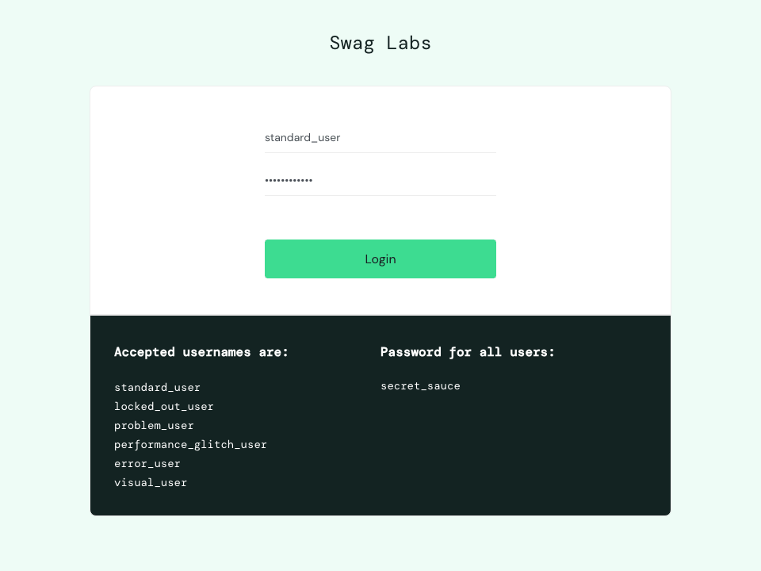
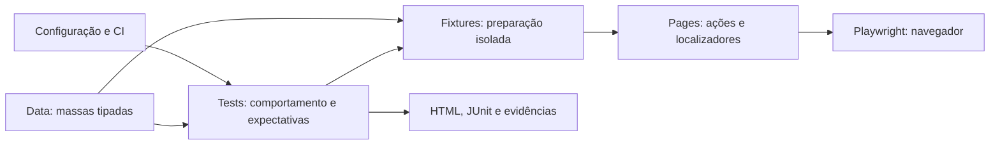

<div align="center">

# QA Automation Lab

**Automação Web · Playwright + TypeScript · SauceDemo**

Portfólio de engenharia de qualidade: estratégia de testes, arquitetura de automação e integração contínua para e-commerce.

[](https://github.com/qadevanes-ti/qa-automation-lab/actions/workflows/playwright.yml)


[Manual de estudo](docs/MANUAL.md) · [Manual em PDF](docs/manual-qa-automation-lab.pdf) · [Plano de testes](docs/TEST-PLAN.md)

</div>

**Autor:** [Adevanes](https://github.com/qadevanes-ti)

## Objetivo

Validar a jornada de compra de um e-commerce com uma suíte E2E organizada por domínio, cobrindo autenticação, catálogo, carrinho e checkout. O projeto demonstra planejamento de cobertura, implementação com Page Object Model, isolamento de cenários e diagnóstico de falhas. Aplicação: [SauceDemo](https://www.saucedemo.com), loja pública para treinamento. As compras são simuladas.

## Competências demonstradas

- Planejamento de cenários positivos e negativos com rastreabilidade por identificador.
- Automação em TypeScript com tipagem estrita e Page Object Model.
- Preparação de cenários isolados e execução paralela em três motores de navegador.
- Validação de regras de negócio: persistência, remoção seletiva e totais de compra.
- Diagnóstico com relatórios HTML, JUnit, screenshots, vídeos e traces.
- Integração contínua com GitHub Actions e documentação reproduzível.

## Resultado de validação

Execução local em **28/10/2026**: **63 testes aprovados**, correspondentes a 21 cenários em Chromium, Firefox e WebKit. A checagem estática de tipos também foi aprovada. Esse resultado registra a validação local; a pipeline deve ser acompanhada na aba Actions após a publicação.

## Demonstração



Captura de uma execução real no Chromium. Para acompanhar ao vivo na sua máquina, use `npm run test:demo`. A animação apresenta o fluxo; as assertivas da suíte são responsáveis pela validação.

## Comece aqui

Pré-requisitos: Node.js 22.13 ou superior e npm. Execute na pasta que contém `package.json`:

```bash
npm ci
npx playwright install
npm run typecheck
npm run test:chromium
npm run report
```

Em Linux, use `npx playwright install --with-deps`. O relatório abre com o comando `report`.

## Arquitetura



```text
src/
  data/             Credenciais públicas, produto e comprador fictício
  fixtures/         Objetos de página e autenticação por teste
  pages/            Login, catálogo, carrinho e checkout
tests/              Cenários por domínio, com identificadores estáveis
docs/               Manual, plano de testes e PDF
scripts/            Geração reproduzível do manual
.github/workflows/  Pipeline de verificação e execução
playwright.config.ts  Navegadores, relatórios, tentativas e evidências
```

## Cobertura

| Domínio  | Cenários | Principais verificações                                               |
| -------- | -------: | --------------------------------------------------------------------- |
| Login    |        6 | Sucesso, inválido, bloqueado, obrigatoriedade, logout                 |
| Catálogo |        4 | Nome e preço em ambas as direções                                     |
| Carrinho |        4 | Adição, identidade, preço e remoção                                   |
| Checkout |        7 | Compra simples e múltipla, totais, cancelamento e campos obrigatórios |

São 21 cenários, configurados em três navegadores (63 execuções). A seleção `@smoke` cobre login, adição ao carrinho e compra completa.

## Comandos

| Comando                 | Finalidade                                          |
| ----------------------- | --------------------------------------------------- |
| `npm test`              | Executar Chromium, Firefox e WebKit                 |
| `npm run test:chromium` | Executar os 21 cenários no Chromium                 |
| `npm run test:smoke`    | Executar três cenários essenciais                   |
| `npm run test:demo`     | Ver a compra ao vivo no navegador, com ações lentas |
| `npm run test:ui`       | Explorar testes na interface do Playwright          |
| `npm run test:debug`    | Depurar com Inspector                               |
| `npm run test:list`     | Listar cenários sem abrir navegador                 |
| `npm run lint`          | Verificar problemas de código e promises sem await  |
| `npm run format:check`  | Verificar a formatação                              |
| `npm run format`        | Formatar os arquivos                                |
| `npm run quality`       | Executar lint, formatação e tipos                   |
| `npm run typecheck`     | Verificar os tipos TypeScript                       |
| `npm run report`        | Abrir relatório HTML                                |
| `npm run docs:pdf`      | Gerar PDF a partir do manual                        |

Exemplo de filtro: `npx playwright test --project=chromium --grep AUTH-03`.
Para outro ambiente compatível com o SauceDemo, use `BASE_URL=https://seu-ambiente npm run test:chromium` (bash/zsh). Arquivos `.env` não são carregados automaticamente.

## Rotina de trabalho

```bash
# Antes de entregar uma alteração: lint, formatação, tipos e suíte Chromium
npm run check

# Executar por funcionalidade
npm run test:login
npm run test:catalog
npm run test:cart
npm run test:checkout

# Regressão completa nos três navegadores
npm run test:regression

# Ver o navegador durante os testes
npm run test:headed

# Demonstração de compra com ações lentas
npm run test:demo

# Repetir um caso para investigar instabilidade
npx playwright test --project=chromium --grep CART-03 --repeat-each=5
```

Consulte o [guia de comandos](docs/COMMANDS.md) para instalação, filtros, depuração e relatórios.

## Qualidade e CI

A pipeline instala dependências pelo lockfile, verifica lint, formatação e tipos e executa os três navegadores em Node 22. Guarda HTML, JUnit e evidências por 14 dias. Localmente, falhas retêm screenshot, vídeo e trace; esses arquivos ficam fora do Git. Duas novas tentativas são permitidas no CI; resultados flaky precisam de investigação.

Cada cenário recebe um contexto isolado, sem dependência de ordem ou sessão global. Seletores usam `data-test`, com configuração explícita de `getByTestId`. Ações usam as esperas nativas do Playwright.

## Decisões e limites

A arquitetura separa regras de negócio nos testes, interações nas páginas, preparação nas fixtures e massas tipadas em arquivos de dados. Essa divisão reduz duplicação e concentra a manutenção dos localizadores. Playwright Test organiza cenários e etapas com `test.step`; a implementação utiliza os recursos nativos de espera e isolamento do framework.

O SauceDemo é externo e pode mudar ou ficar indisponível. A suíte cobre fluxos funcionais; acessibilidade, desempenho, pagamentos reais e testes de segurança estão fora do escopo. Não há custo de licença nas ferramentas; eventuais limites de minutos e armazenamento do GitHub Actions dependem da conta.

## Evolução sugerida

Estudar testes de API em uma aplicação com contrato documentado, verificações de acessibilidade e detalhes de produto. Persistência, múltiplos produtos e cancelamento do checkout já estão cobertos.

## Referências

[Page Objects](https://playwright.dev/docs/pom) · [Fixtures](https://playwright.dev/docs/test-fixtures) · [Trace Viewer](https://playwright.dev/docs/trace-viewer)

Licença MIT.
